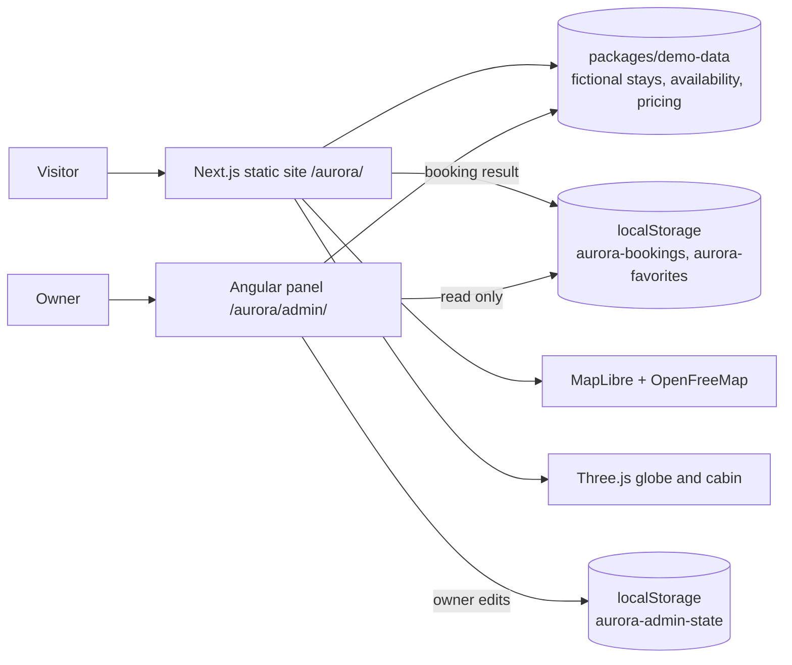

# AURORA · Night Atlas

A fictional travel-platform concept by Andrii Tsap. **Concept / demo project — fictional data.**

[Live demo](https://andriu-tsap.github.io/aurora/) · [Validation](docs/VALIDATION.md) · [Licenses](licenses/README.md)

A browsable demo of a stays-booking platform: landing with a 3D globe, a filterable catalogue with a map, property pages with a code-built 3D cabin, a full demo booking flow (test cards only, PDF voucher with QR, guest account, favourites) and an Angular owner panel at [`/admin/`](https://andriu-tsap.github.io/aurora/admin/). EN / PL / UA. There is no backend: all data is fictional and everything the visitor does stays in their own browser (`localStorage`).

## Technologies

| Area | Technology | Where |
| --- | --- | --- |
| Public site | Next.js 15 (static export), React 19, strict TypeScript, custom CSS (tokens "Night Atlas") | `apps/web` |
| 3D | Three.js via React Three Fiber / drei: globe and a code-built A-frame cabin (~79k triangles, PBR, soft shadows) | `apps/web` |
| Map | MapLibre GL with OpenFreeMap tiles | `apps/web` |
| Booking (demo) | availability and price quote logic, test-card payment form, PDF voucher with vector QR (pdf-lib), confetti, email preview | `apps/web`, `packages/demo-data` |
| Owner panel | Angular 22 (standalone components, signals, zoneless), hash routes, own i18n | `apps/admin` |
| Panel features | property CRUD with photo compression, occupancy calendar (keyboard accessible), SVG revenue chart, CSV and Excel export | `apps/admin` |
| Shared logic | pure TypeScript with unit tests (Vitest, 67 tests) | `packages/demo-data`, `packages/types` |
| Languages | EN / PL / UA, typed message files | `apps/web`, `apps/admin` |
| Tests | Playwright e2e (35 tests), Vitest, Lighthouse (report only) | `tests`, `scripts` |
| Build and deploy | pnpm + Turborepo, GitHub Actions, GitHub Pages (one artifact serves the site and the panel) | `.github/workflows` |

## Architecture

The public site and the panel share the same demo data package. The panel never changes the public site; it only reads the demo bookings made in the same browser.

## What is not in this version

Stages 4, 6 and 7 were deliberately left out, so the project makes no claim about them: a Node.js API with PostgreSQL, real payments and WebSocket (4), a Python service and a Telegram bot (6), a WordPress plugin, an embeddable availability widget, an AI trip planner and a PWA (7). Everything shown as payment, email or notification is a demo and says so on screen.

## Measured quality (local, report only)

Lighthouse mobile, 2026-11-16: home 98 / 100 / 100 / 100, catalogue 95 / 100 / 100 / 100, property page 99 / 100 / 100 / 100, 3D cabin 97 / 100 / 100 / 100, owner panel 99 / 100 / 100 / 60 (SEO is low by design: a demo panel that should not be indexed). Order: performance / accessibility / best practices / SEO. Full results, and what was not verified, are in [docs/VALIDATION.md](docs/VALIDATION.md).

## Structure

- `apps/web`: Next.js 15, React, strict TypeScript, Tailwind utilities and custom CSS, Motion, GSAP, next-intl, React Three Fiber/drei.
- `packages/ui`: shared design tokens for the future Angular UI.
- `scripts/generate-globe.py`: reproducible Natural Earth point cloud and lightweight geographic poster.
- `tests/hero.spec.ts`: desktop/mobile, language, keyboard, motion preference and WebGL failure coverage.
- `licenses`: data/font license records.

## Globe behavior

Mobile, reduced-motion and data-saver visitors receive the pre-rendered WebP geographic poster first. Mobile loads WebGL only after activation. Desktop loads it after the first paint. The poster remains visible during loading and on WebGL failure. Land points and hemisphere lighting create depth; a Fresnel shader adds atmosphere. Arcs show three illustrative routes. Click a marker to view a destination or use the equivalent native HTML controls. Pause is available, and the render loop stops when the scene is offscreen.

## Status by stage

| Stage | Scope | Status |
| --- | --- | --- |
| 0 | Architecture, deploy | ✅ |
| 1 | Hero with 3D globe | ✅ |
| 2 | Catalogue, map, property pages, 3D cabin | ✅ |
| 3 | Booking calendar and quote, demo payment, PDF voucher with QR, guest account, favourites | ✅ accepted |
| 4 | Node.js server, PostgreSQL, real Stripe, WebSocket | ❌ not implemented in this version |
| 5 | Angular 22 owner panel at `/admin/` (demo mode, no backend) | ✅ accepted |
| 6 | Python service, Telegram bot | ❌ not implemented in this version |
| 7 | WordPress plugin, `<aurora-availability>` widget, AI planner, PWA | ❌ not implemented in this version |
| 8 | Final README, validation checklist, Lighthouse, ZIP | ✅ shortened version done |

Final handoff after the accepted stages: one source ZIP excluding dependencies/secrets/caches, prebuilt public and admin exports, a per-feature honest status checklist, screenshots and measured Lighthouse reports.

## Stage 3: booking (demo)

- Availability calendar and price quote on `/stays/<slug>/`. Busy nights are deterministic fictional data, the same for every visitor.
- Checkout is a demo form: only test cards work (`4242 4242 4242 4242` succeeds, `4000 0000 0000 0002` is declined). No payment is processed and no email is sent. Card data is never stored; only the booking result is saved in `localStorage` (`aurora-bookings`).
- PDF voucher with a vector QR code in EN/PL/UA (DejaVu Sans embedded), generated in the browser on demand.
- Guest account at `/account/` (list, cancel, voucher) and favourites (`aurora-favorites`). The confirmation shows confetti and a preview of the confirmation email, labelled as a demo.
- Verified: full browser suite 27/27; Lighthouse mobile (local lab) home 96–98, `/stays/<slug>/` 97, `/account/` 99 performance, accessibility 100. Screenshots with a self-assessment: [stage 3](docs/visual-reviews/stage-3/). Details and limits: [validation](docs/VALIDATION.md).

## Stage 5: owner panel (demo)

- `/aurora/admin/` (Angular 22, hash routes, no backend). Demo sign-in has no password; the "Demo data" badge is always visible. Everything is stored in this browser only (`localStorage`); the public site's data is never modified.
- Properties: edit nightly prices, add / edit / delete your own properties with photos (compressed in the browser, never uploaded), restore a demo stay.
- Occupancy (`#/occupancy`): month calendar per property (keyboard accessible) that also shows demo bookings made on the public site (`aurora-bookings`), and a fictional revenue chart with CSV and Excel export. The revenue model is stated in the UI; nothing was actually paid.
- Tests: `tests/admin.spec.ts` (8 Playwright tests, no WebGL needed). Screenshots script: `scripts/capture-stage5.mjs` → [docs/visual-reviews/stage-5](docs/visual-reviews/stage-5/). Lighthouse (`scripts/lighthouse.mjs`) reports `/admin/` as a report-only page. Results (and what was not run) are in [validation](docs/VALIDATION.md).

## Stage-1 verification

Five browser tests passed. Lighthouse mobile: **91 / 100 / 100 / 100** (performance / accessibility / best practices / SEO), measured on the static production build in CI. See [the full validation record](docs/VALIDATION.md), [screenshots](docs/visual-reviews/stage-1/) and [Lighthouse HTML](docs/lighthouse/mobile.html). Visual acceptance by the project owner is pending.
