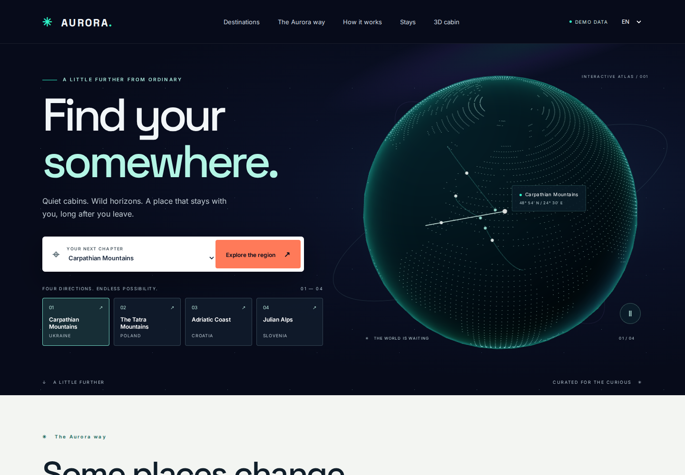

# AURORA · Night Atlas

A fictional travel-platform concept by Andrii Tsap. **Concept / demo project — fictional data.**

[Live demo](https://andriu-tsap.github.io/aurora/) · [Validation](docs/VALIDATION.md) · [Licenses](licenses/README.md)



Implemented so far: landing page with a 3D globe, filterable catalogue with map, property pages, a 3D cabin studio, and a fully demo booking flow (stages 0–3), in EN/PL/UA. There is no backend: all data is fictional and bookings live in the visitor's browser. The owner panel is planned next; see the status list below.

## Local development

Node 22+ and pnpm 11.25:

```sh
pnpm install
pnpm dev
```

```sh
NEXT_PUBLIC_BASE_PATH=/aurora pnpm build
pnpm lint
pnpm typecheck
pnpm exec playwright install chromium
pnpm test:e2e
```

`apps/web/out/` is the complete static Pages artifact. Paths include `/aurora`. The repository's Pages workflow uploads that folder. Browser tests serve it under the same prefix. The separate Visual QA workflow captures screenshots and a Lighthouse report; it never blocks the Pages deployment.

## Structure

- `apps/web`: Next.js 15, React, strict TypeScript, Tailwind utilities and custom CSS, Motion, GSAP, next-intl, React Three Fiber/drei.
- `packages/ui`: shared design tokens for the future Angular UI.
- `scripts/generate-globe.py`: reproducible Natural Earth point cloud and lightweight geographic poster.
- `tests/hero.spec.ts`: desktop/mobile, language, keyboard, motion preference and WebGL failure coverage.
- `licenses`: data/font license records.

## Globe behavior

Mobile, reduced-motion and data-saver visitors receive the pre-rendered WebP geographic poster first. Mobile loads WebGL only after activation. Desktop loads it after the first paint. The poster remains visible during loading and on WebGL failure. Land points and hemisphere lighting create depth; a Fresnel shader adds atmosphere. Arcs show three illustrative routes. Click a marker to view a destination or use the equivalent native HTML controls. Pause is available, and the render loop stops when the scene is offscreen.

## Status by stage

| Stage | Scope | Status |
| --- | --- | --- |
| 0 | Architecture, deploy | ✅ |
| 1 | Hero with 3D globe | ✅ |
| 2 | Catalogue, map, property pages, 3D cabin | ✅ |
| 3 | Booking calendar and quote, demo payment, PDF voucher with QR, guest account, favourites | ✅ implemented, awaiting owner acceptance |
| 4 | Node.js server, PostgreSQL, real Stripe, WebSocket | ❌ not implemented in this version |
| 5 | Angular owner panel (demo mode, no backend) | ⏳ planned next |
| 6 | Python service, Telegram bot | ❌ not implemented in this version |
| 7 | WordPress plugin, `<aurora-availability>` widget, AI planner, PWA | ❌ not implemented in this version |
| 8 | Final README, validation checklist, Lighthouse, ZIP | ⏳ planned (shortened) |

Final handoff after the accepted stages: one source ZIP excluding dependencies/secrets/caches, prebuilt public and admin exports, a per-feature honest status checklist, screenshots and measured Lighthouse reports.

## Stage 3: booking (demo)

- Availability calendar and price quote on `/stays/<slug>/`. Busy nights are deterministic fictional data, the same for every visitor.
- Checkout is a demo form: only test cards work (`4242 4242 4242 4242` succeeds, `4000 0000 0000 0002` is declined). No payment is processed and no email is sent. Card data is never stored; only the booking result is saved in `localStorage` (`aurora-bookings`).
- PDF voucher with a vector QR code in EN/PL/UA (DejaVu Sans embedded), generated in the browser on demand.
- Guest account at `/account/` (list, cancel, voucher) and favourites (`aurora-favorites`). The confirmation shows confetti and a preview of the confirmation email, labelled as a demo.
- Not yet recorded here: Lighthouse for the stay page and `/account/`, and fresh stage-3 screenshots. They will be added separately; see [validation](docs/VALIDATION.md).

## Stage-1 verification

Five browser tests passed. Lighthouse mobile: **91 / 100 / 100 / 100** (performance / accessibility / best practices / SEO), measured on the static production build in CI. See [the full validation record](docs/VALIDATION.md), [screenshots](docs/visual-reviews/stage-1/) and [Lighthouse HTML](docs/lighthouse/mobile.html). Visual acceptance by the project owner is pending.
